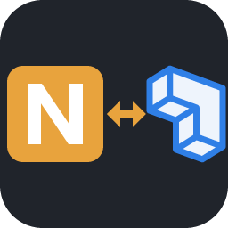
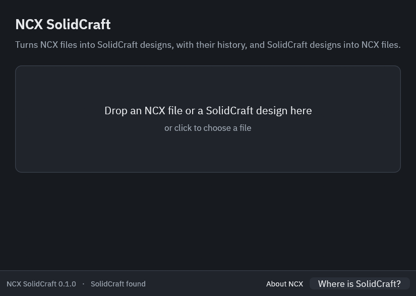
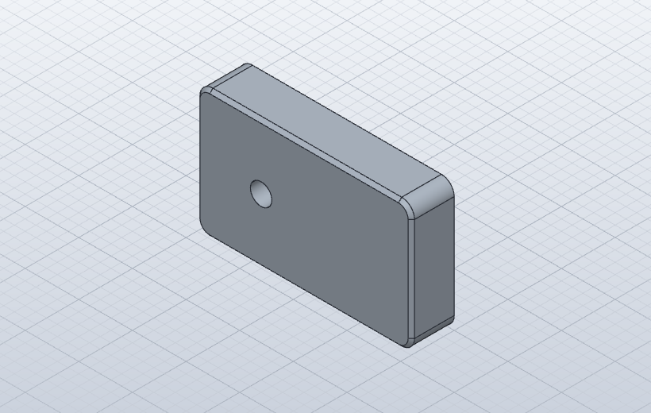
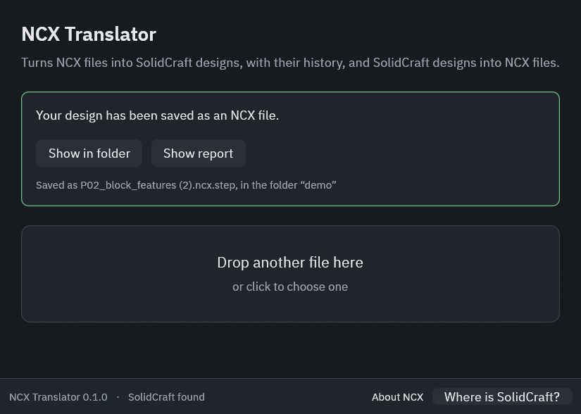

# NCX SolidCraft



A small desktop program that turns NCX files into SolidCraft designs, with their feature history, and SolidCraft
designs into NCX files. Drop a file on its window (or on its icon, or use "Open with"):

- an NCX file (`.ncx.step`, `.step`, `.stp`) becomes a SolidCraft design (`.sc`) beside it;
- a SolidCraft design (`.sc`) becomes an NCX file (`.ncx.step`) beside it.

It never overwrites a file: if the name is taken it saves as `name (2).sc`. It needs SolidCraft installed on the
same computer: it drives SolidCraft's own command-line program (`solidcraft-cli`) in a private, hidden session, so
SolidCraft's own window, and any design open there, is never touched.

## Part of NCX: the other CAD systems

NCX SolidCraft is one part of **[NCX (Neutral CAD eXchange)](../README.md)**, a single-file format that carries a
complete parametric model between CAD systems. This program covers the SolidCraft side only. To move a model
between SolidCraft and another CAD system, whoever uses the other system needs the NCX add-in for it:

- **SolidWorks** (2018 and later): [install the NCX add-in for SolidWorks](../README.md#installing-the-solidworks-add-in).
- **Autodesk Fusion**: [install the NCX add-in for Fusion](../README.md#installing-the-fusion-add-in).

For example, to send a SolidWorks part to SolidCraft: in SolidWorks choose *File > NCX Translator > Export
Neutral (NCX)...*, then drop the NCX file it saves on NCX SolidCraft. The other way round: drop your SolidCraft
design on NCX SolidCraft, then import the NCX file it makes with the add-in (SolidWorks: *File > NCX Translator >
Import Neutral (NCX)...*; Fusion: *File > Import NCX...*).

Without an add-in, any CAD program still opens an NCX file as plain geometry (STEP), without the feature history.
For other CAD systems, see [the main page](../README.md), including how to add one.

## What it looks like

Drop a file on the window, or click to choose one:



The import rebuilds the model feature by feature, and shows where it has got to. **Cancel** stops it and leaves
no half-made design behind:


When it is done it says so in one line, and offers to open the design in SolidCraft. Anything worth knowing
in detail is in the report saved beside the design:


The design in SolidCraft: a SolidWorks part (sample P02, made Y-up) rebuilt with its sketches, extrude, cut,
fillets and chamfer, and stood upright for SolidCraft's Z-up world:



Dropping a SolidCraft design on the window makes an NCX file beside it:



## Download

One program for each operating system SolidCraft runs on. Each release of the translator is tagged
`solidcraft-v<version>` and holds the installer for every system that version supports.

| system | download | state |
|---|---|---|
| Windows 10 and 11 (64-bit) | **[NCX-SolidCraft-0.1.1.msi](https://github.com/SimonRafferty/Neutral-CAD-eXchange-NCX/releases/download/solidcraft-v0.1.1/NCX-SolidCraft-0.1.1.msi)** | tested |
| Linux (x86_64, glibc 2.35 or later) | **[NCX-SolidCraft-0.1.1-x86_64.AppImage](https://github.com/SimonRafferty/Neutral-CAD-eXchange-NCX/releases/download/solidcraft-v0.1.1/NCX-SolidCraft-0.1.1-x86_64.AppImage)** | **untested**: built and checked automatically, but not yet tried on a Linux computer |
| macOS 11 or later (Apple silicon and Intel) | **[NCX-SolidCraft-0.1.1-macos.dmg](https://github.com/SimonRafferty/Neutral-CAD-eXchange-NCX/releases/download/solidcraft-v0.1.1/NCX-SolidCraft-0.1.1-macos.dmg)** | **untested**: built and checked automatically, but not yet tried on a Mac |

All three are on the [release page](https://github.com/SimonRafferty/Neutral-CAD-eXchange-NCX/releases/tag/solidcraft-v0.1.1).
The Linux and macOS versions are built by GitHub from the same source as the Windows one, and the NCX core's own
tests pass on both, but nobody has run them on a real Linux computer or Mac yet. If you try one, please say how it
went in a [GitHub issue](https://github.com/SimonRafferty/Neutral-CAD-eXchange-NCX/issues).

A design made on one system opens in SolidCraft on the others, so a Windows user can import an NCX file and pass
the design to someone on Linux or a Mac.

## Install (Windows)

Download the MSI from the table above, run it and follow the steps (it asks for administrator permission once). It installs
for all users in `C:\Program Files\NCX SolidCraft`, with a Start menu and a desktop shortcut, and adds NCX
SolidCraft to "Open with" for STEP files and SolidCraft designs. Uninstall it from Windows' *Installed apps*.
If Windows says "Windows protected your PC", click **More info**, then **Run anyway** (the installer is not signed
with a paid certificate).

## Install (Linux, untested)

1. Install SolidCraft from its `.deb`, `.rpm` or `.tar.gz` package. NCX SolidCraft needs SolidCraft's
   command-line program, `solidcraft-cli`; the AppImage, Flatpak and Snap versions of SolidCraft keep it inside
   themselves, where NCX SolidCraft cannot reach it.
2. Download the AppImage from the table above, make it executable (right-click > Properties > Allow executing
   as program, or `chmod +x NCX-SolidCraft-0.1.1-x86_64.AppImage`) and double-click it.
3. If it says SolidCraft was not found, click **Where is SolidCraft?** and choose `solidcraft-cli`.

## Install (macOS, untested)

1. Install SolidCraft, and also download SolidCraft's command-line program
   (`solidcraft-cli-<version>-macos-universal.zip`, on the same SolidCraft release page) and double-click it to
   unzip it. Leave the folder in Downloads, or copy `solidcraft-cli` to `/usr/local/bin`.
2. Open the `.dmg` from the table above and drag **NCX SolidCraft** onto **Applications**.
3. The first time, right-click NCX SolidCraft in Applications and choose **Open** (it is not signed with a paid
   Apple certificate, so macOS asks once).
4. Drop files on its window (dropping them on its Dock icon does nothing yet). If it says SolidCraft was not
   found, click **Where is SolidCraft?** and choose `solidcraft-cli`.

## What it carries (this version)

- **Import:** single parts are rebuilt natively, feature by feature (sketches with their relations and
  dimensions, parameters and equations, extrudes and cuts, revolves, fillets, chamfers, offset planes), and
  checked against the file's own fingerprints. A feature it cannot rebuild comes in as the shape the file
  carries for it; a part whose rebuild does not match comes in as the file's own geometry, and the report says
  why. Assemblies and layout-driven parts come in as their geometry for now. Y-up models are stood upright.
- **Export:** the design's exact shape and its parameters, written as a part without feature history (`plain`).
  The feature history follows in a later version.

Every run saves a report beside its output (`<name>.ncx-report.txt`). The window only mentions a problem when
there is a serious one.

## Build

Needs Rust (stable, MSVC), the Visual Studio C++ build tools (the NCX core is C++) and, for the installer, the
WiX 3 tools.

```
cd solidcraft
cargo build --release                                   # target\release\ncx-solidcraft.exe
powershell -ExecutionPolicy Bypass -File installer\build-msi.ps1   # installer\out\NCX-SolidCraft-<ver>.msi
```

The version is set in `Cargo.toml` only. The NCX core (`../core`) is compiled into the program by `build.rs`; the C
runtime is linked statically (`.cargo/config.toml`), so the program needs nothing but Windows.

**Linux and macOS** are built by the GitHub Actions workflow `.github/workflows/ncx-solidcraft.yml` (run by hand,
optionally adding the builds to a release): it runs the NCX core's self-test, then `cargo build --release` and
`packaging/linux/make-appimage.sh` on Ubuntu 22.04, and the Apple-silicon and Intel builds and
`packaging/macos/make-dmg.sh` on macOS. The same scripts work on your own Linux computer or Mac.

Command line (for testing):

```
ncx-solidcraft import <file.ncx.step> <design.sc> [--log] [--plain]
ncx-solidcraft export <design.sc> <file.ncx.step> [--log]
```

`--log` writes every SolidCraft command and its answer beside the output. `results/solidcraft/run_corpus.py` runs
the sample corpus and compares each run with the last.

## Look

The window uses egui, the toolkit SolidCraft is built with, and the IBM Plex Sans font (SIL Open Font License,
`assets/fonts/OFL.txt`), in NCX's own colours. The icon (a stepped block between two chevrons) was drawn for the
project: `assets/icon-source.jpg`, made into the icon files by `assets/make_icon.py`. SolidCraft's theme, colours, logo and icons are under its Brand and Interface Licence
and are not used.
