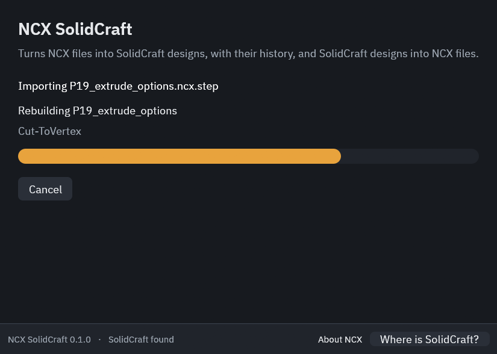
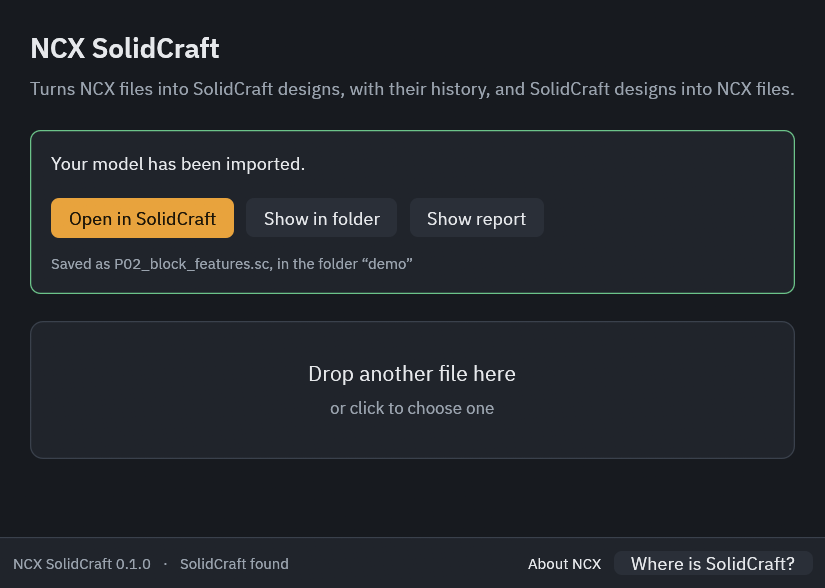

# NCX SolidCraft


A small desktop program that turns NCX files into SolidCraft designs, with their feature history, and SolidCraft
designs into NCX files. Drop a file on its window (or on its icon, or use "Open with"):

- an NCX file (`.ncx.step`, `.step`, `.stp`) becomes a SolidCraft design (`.sc`) beside it;
- a SolidCraft design (`.sc`) becomes an NCX file (`.ncx.step`) beside it.

It never overwrites a file: if the name is taken it saves as `name (2).sc`. It needs SolidCraft installed on the
same computer: it drives SolidCraft's own command-line program (`solidcraft-cli`) in a private, hidden session, so
SolidCraft's own window, and any design open there, is never touched.

## What it looks like

Drop a file on the window, or click to choose one:


The import rebuilds the model feature by feature, and shows where it has got to. **Cancel** stops it and leaves
no half-made design behind:



When it is done it says so in one line, and offers to open the design in SolidCraft. Anything worth knowing
in detail is in the report saved beside the design:



The design in SolidCraft: a SolidWorks part (sample P02, made Y-up) rebuilt with its sketches, extrude, cut,
fillets and chamfer, and stood upright for SolidCraft's Z-up world:


Dropping a SolidCraft design on the window makes an NCX file beside it:


## Download

One program for each operating system SolidCraft runs on. Each release of the translator is tagged
`solidcraft-v<version>` and holds the installer for every system that version supports.

| system | download | state |
|---|---|---|
| Windows (64-bit) | first release coming: see [Releases](https://github.com/SimonRafferty/Neutral-CAD-eXchange-NCX/releases) | 0.1.0: MSI built, installed and tested (Windows 10), sample files |
| Linux | | planned (the shared core already builds for it) |
| macOS | | planned (the shared core already builds for it) |

A design made on one system opens in SolidCraft on the others, so a Windows user can import an NCX file and pass
the design to someone on Linux or a Mac.

## Install (Windows)

Run `NCX-SolidCraft-<version>.msi` and follow the steps (it asks for administrator permission once). It installs
for all users in `C:\Program Files\NCX SolidCraft`, with a Start menu and a desktop shortcut, and adds NCX
Translator to "Open with" for STEP files and SolidCraft designs. Uninstall it from Windows' *Installed apps*.
If Windows says "Windows protected your PC", click **More info**, then **Run anyway** (the installer is not signed
with a paid certificate).

## What it carries (this version)

- **Import:** single parts are rebuilt natively, feature by feature (sketches with their relations and
  dimensions, parameters and equations, extrudes and cuts, revolves, fillets, chamfers, offset planes), and
  checked against the file's own fingerprints. A feature it cannot rebuild comes in as the shape the file
  carries for it; a part whose rebuild does not match comes in as the file's own geometry, and the report says
  why. Assemblies and layout-driven parts come in as their geometry for now. Y-up models are stood upright.
- **Export:** the design's exact shape and its parameters, written as a part without feature history (`plain`).
  The feature history follows in a later version.

Every run saves a report beside its output (`<name>.ncx-report.txt`). The window only mentions a problem when
there is a serious one.

## Build

Needs Rust (stable, MSVC), the Visual Studio C++ build tools (the NCX core is C++) and, for the installer, the
WiX 3 tools.

```
cd solidcraft
cargo build --release                                   # target\release\ncx-solidcraft.exe
powershell -ExecutionPolicy Bypass -File installer\build-msi.ps1   # installer\out\NCX-SolidCraft-<ver>.msi
```

The version is set in `Cargo.toml` only. The NCX core (`../core`) is compiled into the program by `build.rs`; the C
runtime is linked statically (`.cargo/config.toml`), so the program needs nothing but Windows.

Command line (for testing):

```
ncx-solidcraft import <file.ncx.step> <design.sc> [--log] [--plain]
ncx-solidcraft export <design.sc> <file.ncx.step> [--log]
```

`--log` writes every SolidCraft command and its answer beside the output. `results/solidcraft/run_corpus.py` runs
the sample corpus and compares each run with the last.

## Look

The window uses egui, the toolkit SolidCraft is built with, and the IBM Plex Sans font (SIL Open Font License,
`assets/fonts/OFL.txt`), in NCX's own colours. The icon (a stepped block between two chevrons) was drawn for the
project: `assets/icon-source.jpg`, made into the icon files by `assets/make_icon.py`. SolidCraft's theme, colours, logo and icons are under its Brand and Interface Licence
and are not used.
